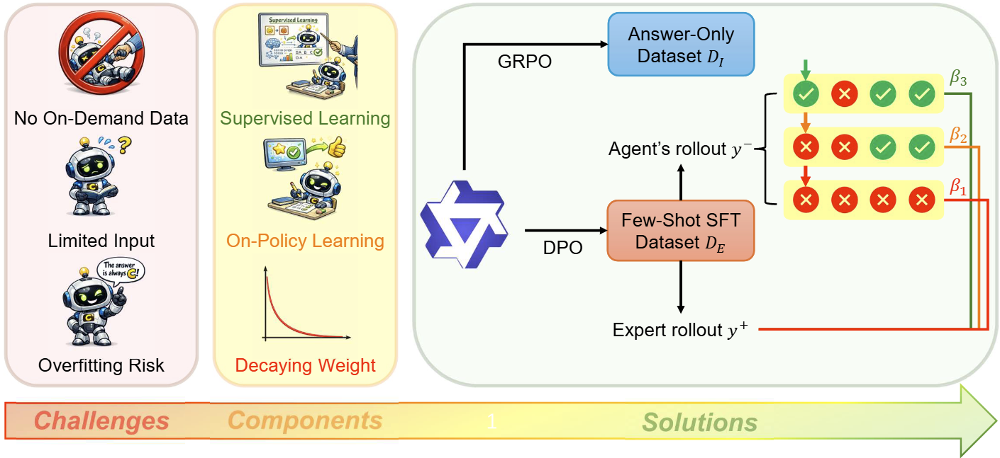

<h1  align="center"> Boosting Reinforcement Learning with Verifiable Rewards via Randomly Selected Few-Shot Guidance</h1>



This is the code repository for the paper "Boosting Reinforcement Learning with Verifiable Rewards via Randomly Selected Few-Shot Guidance", a work that aims to squeeze performance gain for RLVR using only minimal amount of  SFT data. The codebase is built on the basis of [ReLIFT](https://github.com/TheRoadQaQ/ReLIFT/tree/main), and integrate implementation for [HPT](https://github.com/TheRoadQaQ/ReLIFT/dataset), [LUFFY](https://github.com/ElliottYan/LUFFY) and [CHORD-φ](https://github.com/agentscope-ai/Trinity-RFT/tree/main/examples/mix_chord). 

- 📜 [Paper (arXiv)] To be updated soon. Stay tuned!

- 🤗 [HuggingFace Collection](https://huggingface.co/collections/kaiyan289/fest)

# Getting Started

  
## Installation

### ARM Architecture

Due to computational resource limit, we run our experiments mostly on ARM architecture, which could be a bit tricky to set up. We thank [Ziqi Pang](https://ziqipang.github.io/) for providing guidance on this part.

**Step 1: Setting Up Docker**

We use NVIDIA Pytorch container [Release 25.01](https://docs.nvidia.com/deeplearning/frameworks/pytorch-release-notes/rel-25-01.html). To install it, run the following command:

```
# this docker contains torch 2.6.0 which we use in our experiments. As flash-attn and vllm are sensitive to torch version, you may need to choose your own version of docker. 
apptainer pull --tmpdir ~/test_ngc/tmp torch2501.sif docker://nvcr.io/nvidia/pytorch:25.01-py3

# use --bind to bind any directory that you need to use. You may also need to bind some library for specific CUDA libraries.
apptainer shell --bind /projects,/work,/u --nv torch2501.sif 
pip install virtualenv
python -m virtualenv verl --system-site-packages
source verl/bin/activate
```

A rule of thumb to check whether you install the docker correctly or not is to import torch and check torch.cuda.is_available(). It should be True before you proceed to the next step.

**Step 2: Install vllm**

Unfortunately, vllm does not natively support ARM architecture and thus you need to compile from code. In our experiment, we use vllm 0.8.3 (with source branch being v0.8.2). Run the following commands:

```
git clone [https://github.com/vllm-project/vllm.git](https://github.com/vllm-project/vllm.git)
git checkout v0.8.2
# important to run this python script and prevent vllm from installing pytorch of its own. If this happens, you need to remove your .sif docker file, and start over from step 1.
python use_existing_torch.py
pip install -r requirements/build.txt
# limit MAX_JOBS to prevent memory overflow if you only have limited memory. This step can take ~2 hours to finish. Do not forget --no-build-isolation!
MAX_JOBS=5 pip install --no-build-isolation -e .
```

**Step 3: Install verl**

We build our codebase based on verl 0.4.0. Go into the verl subfolder of our repository, and run the following command:

```
MAX_JOBS=5 pip install --no-build-isolation -e .
```

**Step 4: Install the Other Packages**

Run our script, and install any missing package on demand (e.g. accelerate, peft, etc.) **Always do a pip --dry-run before you install the packages to prevent messing up pytorch - if this happens, you need to remove .sif file and go back to step 1.**

### x86-64 Architecture  

For x86-64 architecture, things are a lot easier as you can simply use conda environments. Here is a list of key packages we use under python 3.12.3 and CUDA 12.8:

```
accelerate==1.12.0
flash_attn==2.7.3
hydra-core==1.3.2
math-verify==0.8.0
numpy==1.26.4
peft==0.18.1
protobuf==6.33.5
ray==2.53.0
tensordict==0.1.2
torch==2.6.0
torchdata==0.11.0
transformers==4.57.6
sympy==1.13.1
vllm==0.8.3
wandb==0.24.1
```

Alternatively, you can also use the following environment under python 3.10.18 and CUDA 12.4: 

```
accelerate==1.10.1
flash_attn==2.7.3
hydra-core==1.3.2
math-verify==0.8.0
numpy==1.26.4
peft==0.17.1
protobuf==6.32.1
ray==2.49.2
tensordict==0.5.0
torch==2.4.0
torchdata==0.11.0
transformers==4.57.0
sympy==1.14.0
vllm==0.6.3
wandb==0.22.1
```

Note: you may witness spikes on GRPO importance sampling ratio under some version of vllm while not on others. This is normal and probably due to version-specific [training-inference inconsistency](https://yingru.notion.site/When-Speed-Kills-Stability-Demystifying-RL-Collapse-from-the-Training-Inference-Mismatch-271211a558b7808d8b12d403fd15edda).

## Repo Structure

The structure of the repository is organized as follows:  

This repository includes:
-  `ternary_dpo/verl/verl/ternary_dpo`: The main code of our implementation. You should install your verl at `ternary_dpo/verl`, for which most code in other subfolders remain untouched.
    - `main_ppo.py`: The entry point of the training job.
    - `trainer.py`: The code for trainer that contains the main training loop, including rollout, data partition, evaluation and aggregation of metrics.
    - `fsdp_worker.py`: Communication between trainer and actor process, which does preprocessing and postprocessing for data on each GPU.
    - `actor.py`: The code for implementing optimization steps.
    - `core_algos.py`: Implementation for loss function
    - `config`: Place to store default parameters.
    - `reward.py, rl_dataset_with_target.py`: Auxiliary RLVR code.
-  `dataset`: Dataset for training and evaluating our method and baselines.

-  `examples/math-1.5b-v3/*.sh`: scripts to run experiments.

-  `utils`: Some RLVR-related auxiliary code, such as reward function. 
  
# Usage

  

## Data Preparation

### RL Dataset

You can run `dataset/train_data/prepare_train.py` to generate the RL dataset, or alternatively directly use dataset from [HPT](https://github.com/TsinghuaC3I/Unify-Post-Training/tree/main/data). 

### Few-Shot Expert Dataset

We already include datasets in the `dataset/train_data` folder. We also provide our script for sampling few-shot data and filtering by token count in `dataset/train_data/partition_shots.py` and `dataset/train_data/sample_128_by_assistant_tokens.py` respectively.

### Test Set

The test set is already included in the `dataset` folder. Alternatively, you can directly use data from [HPT](https://github.com/TsinghuaC3I/Unify-Post-Training/tree/main/data) for math datasets and [ReLIFT](https://github.com/TheRoadQaQ/ReLIFT/dataset) for MMLU-Pro dataset.  
 

## Model Preparation

We use the same model as [HPT](https://github.com/TsinghuaC3I/Unify-Post-Training/tree/main) and [ReLIFT](https://github.com/TheRoadQaQ/ReLIFT). 

To prepare such model, first download Qwen/Qwen2.5-Math-1.5B from huggingface. Then, modify its `config.json` and set 
```
...
"rope_theta": 40000,
"max_position_embeddings": 16384,
...
```

## Training

We provide scripts for most experiments to train; simply run `./examples/math-1.5b-v3/FEST-DPO.sh` and `./examples/math-1.5b-v3/FEST-GRPO.sh` to run our algorithm.

Here we list the meaning of some hyperparameters:

- **beta_gold_to_lose:** $\beta_1$ in our paper.
- **beta_win_to_lose:** $\beta_2$ in our paper.
- **beta_gold_to_win:** $\beta_3$ in our paper.
- **dpo_loss_ratio:** $c$ in our paper, valid for only our method.
- **dpo_clamp_value:** deprecated and always set to very large negative value; was designed for clipping $z$ value in Appendix D.3. 
-  **special_mode:** determining methods; see scripts for each method for corresponding values.
-  **update_ref_freq, soft_update_factor:** deprecated; we now do not update reference model for DPO, and thus update_ref_freq should always be set to -2.
- **gold_data_weight, rl_data_weight:** the weight coefficient for loss from differfent datasets. Notably, the "xxx_for_weighted" hyperparameter is for fix weight SFT+RL only.
- **gold_files, train_files, val_files:** few-shot training set, RL training set and test set.

## Evaluation

We provide scripts to evalute from either a checkpoint of our repository or a huggingface model. To evaluate, run the following command:

```
# for HF models
sh  ./examples/math-1.5b-v3/evaluate_fromhf.sh 
sh  ./examples/math-1.5b-v3/mmlupro_fromhf.sh 
# for our checkpoint
sh  ./examples/math-1.5b-v3/evaluate_fromoptim.sh 
sh  ./examples/math-1.5b-v3/mmlupro_fromoptim.sh
```

After this, the result will be stored in  `eval_by_question_results`.  Run `eval_by_question_results/read_results.py` to get statistics (e.g. pass@8) for results.

By default, evaluating from our checkpoint always evaluate the last checkpoint stored. To evaluate an earlier checkpoint, go into `train_results/relift/<your checkpoint name>`, and modify the `latest_checkpointed_iteration.txt` to the corresponding checkpoint.
 

## 📖 Citation

  
To be updated once the paper appear on ArXiv. Stay tuned!
